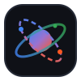

<div align="center">
  
  <h1>Google Antigravity (agy) Driver & Control Panel</h1>
  <p>An official local execution driver and workspace dashboard plugin for <a href="https://github.com/solshevik/cloud-agent">Cloud-Agent</a> (CloudCLI UI)</p>
</div>

<p align="center">
  <a href="https://github.com/solshevik/cloud-agent">Cloud-Agent Gateway</a> · 
  <a href="https://github.com/solshevik/cloudcli-plugin-agy/issues">Report Issue</a> · 
  <a href="README.zh-CN.md">简体中文说明文档</a>
</p>

<p align="center">
  <a href="https://github.com/solshevik/cloudcli-plugin-agy"></a>
  <a href="https://github.com/solshevik/cloudcli-plugin-agy/releases"></a>
  <a href="LICENSE"></a>
</p>

---

## 🌟 Highlights & Key Features

`cloudcli-plugin-agy` decouples local Google Antigravity (`agy`) CLI execution from the host platform, offering a high-performance local AI runtime and full-featured management dashboard for Cloud-Agent.

- **⚡ Zero External Port Architecture**: External clients (Claude Code CLI, Cursor, OpenAI SDK) connect strictly to Cloud-Agent's unified API Gateway (`http://127.0.0.1:3001`). No additional ports (e.g. 3002) or firewall rules are opened. The plugin communicates internally via a randomized loopback port (`127.0.0.1:0`).
- **🛡️ Client Harness & XML Sanitizer**: Automatically detects and purges 500+ lines of client-internal XML wrapper blocks (`<guidelines>`, `<memory_management>`, `<commit_attribution>`, `<tools>`) and timezone metadata, preventing prompt-injection false positives in underlying Gemini and Sonnet models.
- **🔄 Session Continuity Tracking**: Maps client session keys to persistent `agy --conversation <convId>` states in `~/.claude-code-ui/agy-sessions.json`. Supports 10+ turns of continuous context memory (algebra, reasoning, and context recall) with zero drift.
- **⏱️ Instant SSE Stream Termination**: Actively intercepts `agy` CLI's `event: result` and immediately emits `[DONE]`, eliminating terminal hanging and timeouts after output completes.
- **📊 Real-time Dashboard Tab**: Integrates cleanly into Cloud-Agent workspace tabs, providing instant CLI path probing, interactive round-trip latency benchmarking, active session inspection, and cache reset controls.
- **💬 Native Slash Command (`/agy`)**: Automatically exposes the `/agy` command and tool usage guides to the chat composer upon installation.

---

## 📐 Architecture & How It Works

```
┌────────────────────────────────────────────────────────────────────────┐
│  Cloud-Agent Host System (Port 3001)                                   │
│                                                                        │
│  Unified API Gateway: /v1/chat/completions & /v1/messages              │
│    Routes "agy/*" requests internally to plugin RPC                    │
│                                                                        │
│  Plugin Subprocess (dist/server.js):                                   │
│    Runs as a sandboxed child process                                   │
│    Binds to ephemeral loopback port (127.0.0.1:0)                      │
│    Signals ready handshake: {"ready": true, "port": <port>}            │
└───────────────────────┬────────────────────────┬───────────────────────┘
                        │ serves frontend assets │ proxies internal RPC
┌───────────────────────▼────────────────────────▼───────────────────────┐
│  Workspace Frontend (Browser)                                          │
│                                                                        │
│  Plugin Module (dist/index.js)                                         │
│    mount(container, api) → Interactive Control Panel Tab               │
│    api.context           → theme / project / session tracking          │
│    api.rpc('GET', ...)   → status probe & latency benchmarks           │
└────────────────────────────────────────────────────────────────────────┘
                                    │ spawns CLI
                        ┌───────────▼───────────┐
                        │ Local OS Environment  │
                        │ agy binary execution  │
                        └───────────────────────┘
```

---

## 🚀 Installation

### Recommended: Install via Cloud-Agent UI
1. Open Cloud-Agent Web UI (`http://localhost:3001`).
2. Go to **Settings** ➔ **Plugins**.
3. Under **Install Plugin**, paste the repository Git URL:
   ```text
   https://github.com/solshevik/cloudcli-plugin-agy
   ```
4. Click **Install**. The host clones the repo, installs dependencies, builds the TypeScript sources, and enables the plugin.
5. The **Google Antigravity (agy)** tab will appear in your workspace.

### Manual / Developer Softlink
```bash
# 1. Clone repository
git clone git@github.com:solshevik/cloudcli-plugin-agy.git /home/yubs/cloudcli-plugin-agy
cd /home/yubs/cloudcli-plugin-agy

# 2. Install dependencies & build
npm install
npm run build

# 3. Softlink into CloudCLI plugins folder
mkdir -p ~/.claude-code-ui/plugins
ln -s /home/yubs/cloudcli-plugin-agy ~/.claude-code-ui/plugins/cloudcli-plugin-agy
```

---

## 📡 Usage with External Clients

Because of the **Zero-Port Gateway Architecture**, you do not need to configure custom ports. Use Cloud-Agent's primary gateway port (`3001`):

### 1. Claude Code CLI
```bash
export ANTHROPIC_BASE_URL="http://127.0.0.1:3001"
export ANTHROPIC_API_KEY="sk-any-token"

# Start Claude Code
claude
```

### 2. cURL / OpenAI Compatible Clients
```bash
curl -N http://127.0.0.1:3001/v1/chat/completions \
  -H "Content-Type: application/json" \
  -H "Authorization: Bearer YOUR_GATEWAY_TOKEN" \
  -d '{
    "model": "agy/gemini-3.8-flash-low",
    "messages": [{"role": "user", "content": "Explain quantum computing in one sentence"}],
    "stream": true
  }'
```

---

## 🤖 Supported Models Matrix

| Model Identifier | Engine Target | Characteristics |
| :--- | :--- | :--- |
| `agy/gemini-3.8-flash-low` | Gemini 3.8 Flash (Low effort) | Ultra-fast first-token latency (TTFT < 1s), ideal for interactive coding |
| `agy/gemini-3.8-flash-high` | Gemini 3.8 Flash (High effort) | Deep reasoning effort, complex algorithm derivation, architecture design |
| `agy/claude-sonnet-4-6` | Claude Sonnet 4.6 | High-precision coding and structural reasoning |
| `agy/gpt-oss-120b-medium` | GPT-OSS 120B | Open-weight high parameter model for multi-turn structured tasks |

---

## 📂 Plugin Structure

```text
cloudcli-plugin-agy/
├── manifest.json              # Required: Plugin manifest specification
├── package.json               # Dependencies and self-contained build scripts
├── tsconfig.json              # TypeScript compilation configuration
├── icon.svg                   # Antigravity vector logo
├── README.md                  # English documentation
├── README.zh-CN.md            # Chinese documentation
├── scripts/
│   └── build.js               # Resilient fallback build runner
├── skills/
│   └── agy.md                 # Agent skill and /agy slash command declaration
├── src/
│   ├── types.ts               # Host PluginAPI and Unified Protocol contracts
│   ├── index.ts               # Frontend dashboard entry point (mount / unmount)
│   ├── server.ts              # Backend loopback RPC server (127.0.0.1:0)
│   ├── driver.ts              # Core agy CLI process spawn and SSE stream parser
│   ├── prompt-scrubber.ts     # XML Harness and environmental noise sanitizer
│   ├── session-manager.ts     # Multi-turn conversation mapping and persistence
│   └── test/
│       └── driver.test.ts     # Comprehensive unit tests
└── dist/                      # Compiled ESM production output (committed)
    ├── index.js               # Frontend entry referenced by manifest
    ├── server.js              # Backend server referenced by manifest
    └── driver.js              # Direct in-process importable driver class
```

---

## ⚙️ manifest.json Specification

```jsonc
{
  "name": "cloudcli-plugin-agy",
  "displayName": "Google Antigravity (agy)",
  "version": "1.0.0",
  "description": "Local Google Antigravity (agy) execution driver and control dashboard for Cloud-Agent / CloudCLI",
  "icon": "icon.svg",
  "type": "module",              // Native ES Module
  "slot": "tab",                 // Workspace tab slot
  "entry": "dist/index.js",      // Compiled frontend entry
  "server": "dist/server.js",    // Compiled backend child process entry
  "permissions": ["network", "storage"],
  "repository": "https://github.com/solshevik/cloudcli-plugin-agy"
}
```

---

## 🔒 Security & Trust Model

- **Process-Level Isolation**: The backend server runs as an independent OS process with restricted environment variables (`PATH`, `HOME`, `NODE_ENV`, `PLUGIN_NAME`).
- **No Secret Leakage**: Subprocesses do not inherit the host's credentials. Specific keys are injected strictly via `X-Plugin-Secret-*` headers on proxied RPC requests.
- **Loopback Enforcement**: The backend server binds exclusively to `127.0.0.1:0`. It is never exposed directly to external networks.
- **Sanitized Prompts**: Stripping XML wrapper blocks ensures that client-internal scaffolding cannot inject unexpected instructions into the local engine.

---

## 🧪 Testing & Verification

```bash
# Run unit tests
npm test

# Build TypeScript sources
npm run build
```

---

## 📄 License

GNU Affero General Public License v3.0 or later ([AGPL-3.0-or-later](LICENSE)).
